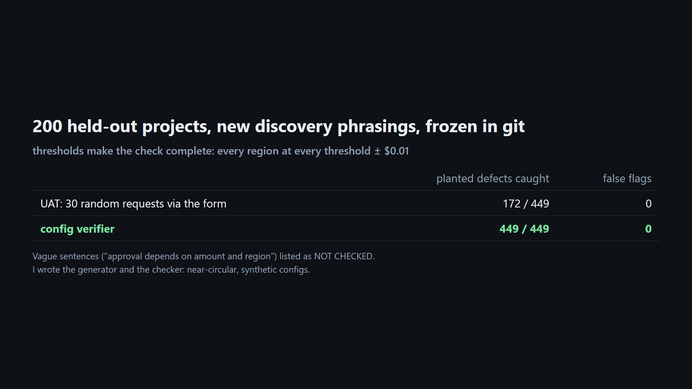

# Verify an ERP implementation config against discovery, before UAT

Unofficial prototype by Kushagra Pratap Singh. Not affiliated with Lab0.

## The problem

[Lab0](https://lab0.ai) builds AI agents for enterprise software implementation. They turn discovery calls into requirements, configure the product, write integrations and test before go-live. Their own homepage example shows the classic miss: "Every request needs a cost center" was enforced on the form while the **import still accepted an empty cost center**.

That class of bug is everywhere in a rollout:

- A rule enforced on one **entry path** (form) but not another (CSV import, API).
- Approval **tiers** with a hole or a double match exactly at the threshold ("under $10,000" + "over $10,000" leaves $10,000 with no approver).
- A regional rule written in the **wrong currency**, region code or **stage** ("finance review" placed after the ERP handoff).
- **ERP mappings** where the destination is required but the source is optional on some path, or the source is longer than the destination field.

UAT catches these only if a tester happens to try the exact boundary amount, or the import file.



## What I built (stdlib only)

- **`implcheck/reqs.py`**: discovery sentences → checkable requirements with their source quote (`FIELD_REQUIRED`, `APPROVER_REQUIRED` with region / over vs and-above / amount / currency / approver, e.g. "£25,000", "25k GBP"). Anything not understood is listed as **NOT CHECKED**, never silently dropped.
- **`implcheck/check.py`**, checks with a **witness request** for every finding:
  - **FIELD_BYPASS**: required on some entry paths but not others.
  - **TIER_GAP / TIER_OVERLAP**: approval tiers must match exactly once per region and amount.
  - **REQ_UNMET**: requirement not met somewhere (FX-converted, aliases like GB = UK, before vs after the ERP handoff).
  - **MAP_MISSING / MAP_NULL_RISK / MAP_TRUNCATION**: problems in the source-to-ERP field mappings.
  - Amount conditions are thresholds, so testing each region at every threshold, ±$0.01 and between thresholds covers **every possible request**. That makes the check complete for this rule language, not a sample.
- **`impact(old, new)`**: for a change request, which (region, amount) cells change approvers, plus the boundary tests to run.

## Result: 200 held-out projects, frozen in git before the first run

The held-out set has new seeds and **different discovery phrasings** ("All purchase requests must have…", "exceeding 25k GBP", "they need a … sign-off").

| | planted defects caught | false flags |
|---|---|---|
| UAT sample run (30 random requests through the form) | 172 / 449 | 0 |
| **config verifier** | **449 / 449** | **0** |

- UAT missed boundary gaps and overlaps (80), import/API bypasses and null-risk mappings (120), and requirement misses in narrow amount bands (74).
- 200 of 800 discovery sentences were reported as NOT CHECKED. Each project includes one deliberately vague sentence ("Approval depends on amount and region"), and that's the honest output for it.
- Dev showed two **generator bugs**, not checker bugs, fixed before freezing: a planted gap plus overlap on the same boundary cancel out into a valid partition, and a look-alike edit could erase a planted defect.

`python demo.py` runs the homepage-style scenario. The current config gets 8 findings (import bypass, $10,000 tier gap, unmet "and above", missing UK finance-director review, mapping null risk, truncation). After the fixes plus change request CR-0248 ("UK over £25,000 → finance director review"), it gets 0 findings, and the impact lists 5 cells to retest, including UK at $31,750.01 (£25,000.01).

**Honest limits**
- I wrote both the project generator and the checker, so this is close to circular. It shows the checks are exact and the parser handles new phrasings, not that it handles real customer configs.
- The rule language is deliberately small: region, amount thresholds, approvers, stage. Real approval engines add roles, cost-center hierarchies, dates and delegation. The boundary-point idea still applies per numeric condition.
- Over-strict rules (asking for review earlier than required) are not flagged. They may be intended.

## Run it

```
python demo.py
python evaluate.py heldout
python -m unittest discover -s tests
```
